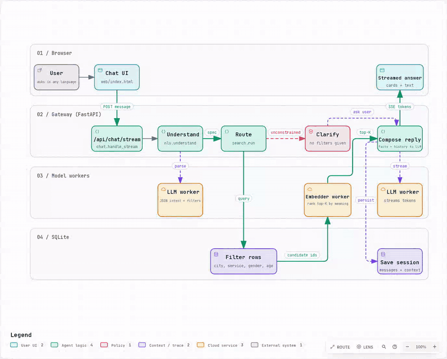
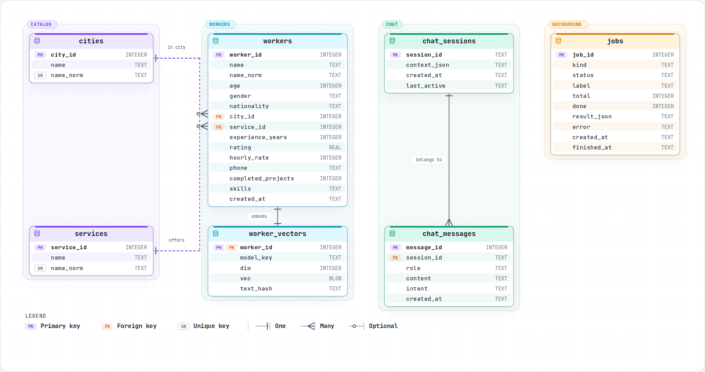
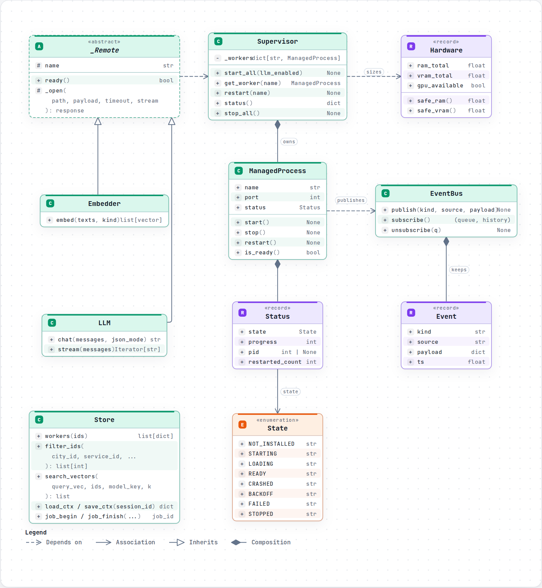

# FindPro

Find the right worker by simply chatting. Ask in Arabic or English, for example *"best rated electrician in Cairo"* or *"how many plumbers under 40?"*, and get worker cards back with rating, hourly rate and a tap-to-call phone number.

Everything runs **locally on your machine**: a small language model understands the question and writes the reply, and an embedding model ranks the results by meaning. No cloud API and no API keys.



## Features

- **Chat in Arabic or English.** Text direction (RTL/LTR) is set per message bubble, with an AR/EN interface toggle and dark mode.
- **Understands follow-ups.** Context is kept per session, so "only the women" or "the cheapest one" refines the previous search.
- **Five kinds of requests:** search, count, look up a person by name, compare workers, and plain chat.
- **Hybrid search.** Filters in SQLite (city, service, gender, age, sort by rating, price or experience), then re-ranks the candidates with embeddings. If nothing matches in a city, it widens the search and tells you.
- **Typo tolerant.** Cities, services and names are matched with fuzzy and semantic matching.
- **Streaming replies** over Server-Sent Events, with a stop button and a retry on errors.
- **Import your own data** from an Excel file. Columns are mapped automatically, even when the headers are in a different language.
- **Hardware aware setup.** The first run detects your RAM and GPU, shows which models fit, and recommends one.
- **Self-healing workers.** The model processes are supervised, restarted on a crash, and loaded one at a time to keep peak RAM low.

## How it works

A chat message goes through the gateway. The local LLM turns it into a structured request, the search layer picks a route (SQL, semantic, fallback or clarify), and the LLM then writes the answer from the facts it was given and streams it back.

The three diagrams in this README are generated from the code. The interactive versions are in [`docs/diagrams`](docs/diagrams) (open the `.html` files in a browser; in the workflow, press **Live** to play the animation), and the full write-up is in [`docs/ARCHITECTURE.md`](docs/ARCHITECTURE.md).

## Database (ERD)

Seven tables in SQLite: the workers catalog with its cities, services and embedding vectors, chat sessions with their messages, and a jobs table that tracks imports and reindexing.



## Runtime classes (UML)

The runtime is built around a `Supervisor` that owns one `ManagedProcess` per model worker, an `EventBus` that feeds live status to the UI, and thin HTTP clients (`Embedder`, `LLM`) that talk to the workers.



## Quick start

**Requirements:** Python 3.10 or newer, an internet connection for the first run (to install libraries and download models), and enough free RAM for the model you choose.

```bash
git clone https://github.com/WaseemMohamed174/findpro.git
cd findpro
python run.py
```

On the first run it walks you through four steps:

1. **Libraries.** Creates separate virtual environments for the gateway, the embedder and the LLM, and installs what is missing.
2. **Model selection.** Detects your hardware and lets you pick an embedding model and a language model. Options that do not fit your machine are grayed out.
3. **Download models.** Fetches the chosen models from Hugging Face.
4. **Launch.** Starts the gateway and opens the chat at <http://127.0.0.1:8000/>.

Then load some data from the **Workers** panel: upload your own Excel file, or use the demo data included in `data/static/workers_data.xlsx` (1000 sample rows).

### Options

| Option | What it does |
|---|---|
| `python run.py --auto` | Skip the questions and use the recommended choices (also `FINDPRO_AUTO=1`) |
| `python run.py --no-llm` | Start without the language model (the embedder only) |

| Environment variable | Default | Purpose |
|---|---|---|
| `FINDPRO_HOST` | `127.0.0.1` | Address the gateway listens on |
| `FINDPRO_PORT` | `8000` | Gateway port |
| `FINDPRO_ADMIN_TOKEN` | empty | Secret for the admin endpoints, sent in the `X-Admin-Token` header. **Required** if `FINDPRO_HOST` is not `127.0.0.1`; see [Security](#security) |
| `FINDPRO_DEBUG` | `0` | `1` also logs user messages and raw model output, and shows tracebacks in `/api/explain` |
| `FINDPRO_NAME_SIM_MIN` | `0.90` | Minimum similarity for finding a person by embedding when the spelling does not match; see [`eval/README.md`](eval/README.md) |
| `FINDPRO_RANK_SIM_WEIGHT` | `0.35` | Share of semantic match (versus rating) in the order of results |

## Models

The catalog is in [`data/static/catalog/models.json`](data/static/catalog/models.json).

| Embedding model | Size | Vector dim |
|---|---|---|
| `paraphrase-multilingual-MiniLM-L12-v2` | 0.47 GB | 384 |
| `multilingual-e5-small` (default) | 0.47 GB | 384 |
| `multilingual-e5-base` | 1.11 GB | 768 |
| `multilingual-e5-large` | 2.24 GB | 1024 |

| Language model (GGUF, via llama.cpp) | Size | Min free RAM |
|---|---|---|
| `Qwen2.5-0.5B-Instruct` | 0.40 GB | 1.0 GB |
| `Qwen2.5-1.5B-Instruct` | 1.12 GB | 2.0 GB |
| `Qwen2.5-3B-Instruct` (default) | 2.10 GB | 3.5 GB |
| `Llama-3.2-3B-Instruct` | 2.02 GB | 3.5 GB |
| `Qwen2.5-7B-Instruct` | 4.68 GB | 7.0 GB |

Before the LLM starts, a RAM check runs. If there is not enough free memory it is marked as failed with a clear message instead of being killed by the OS, and you can retry from the status pill in the UI.

## Importing data

Upload an `.xlsx` file from the UI or `POST /api/upload`. The importer maps your columns to these fields: `name`, `age`, `gender`, `nationality`, `city`, `service`, `experience_years`, `rating`, `hourly_rate`, `phone`, `completed_projects`, `skills`. Only `name`, `city` and `service` are required. A blank template is available at `GET /api/template`.

Common column names in Arabic and English (for example `الاسم`, `المدينة`, `الخدمة الرئيسية`, `Full Name`, `Profession`) and gender values (`ذكر`/`أنثى`, `male`/`female`, `m`/`f`) are recognised directly, so a typical file imports instantly and without a model. The language model is only asked about headers or values it does not know; if it is not ready and a required column cannot be recognised, the import stops and names the missing columns.

## API

Interactive docs are served by FastAPI at `/docs` while the app is running. `session_id` is 8 to 64 characters from `A-Za-z0-9_-` (the web page generates a random one), and a message is at most 2000 characters. Endpoints marked *admin* in the table, and every endpoint that changes data, follow the rules in [Security](#security).

| Group | Endpoints |
|---|---|
| Chat | `POST /api/chat`, `POST /api/chat/stream`, `GET /api/history/{session_id}`, `POST /api/explain` (admin) |
| Workers | `GET/POST/DELETE /api/workers`, `GET/PUT/DELETE /api/workers/{id}` |
| Data jobs | `POST /api/upload`, `POST /api/seed_demo`, `POST /api/reindex`, `GET /api/jobs`, `GET /api/template`, `GET /api/meta` |
| System | `GET /api/system/status`, `GET /api/system/hardware`, `GET /api/system/selection`, `GET /api/system/events` (live stream), `POST /api/system/restart/{name}`, `GET /health` |
| Admin | `POST /api/admin/install/{component}`, `POST /api/admin/download/{component}`, `POST /api/admin/select` |

## Security

The default setup is a single-user tool on your own machine: the server listens on `127.0.0.1` only. In that mode the endpoints that change data (adding, editing or deleting workers, uploading, re-indexing, restarting a model, `/api/explain`, `/api/admin/*`) accept requests from the same machine only, and refuse requests that a web page in your browser sends from another site.

To make the server reachable from other machines, set a token and bind to the address you want:

```bash
export FINDPRO_ADMIN_TOKEN="a-long-random-string"
FINDPRO_HOST=0.0.0.0 python run.py
```

Without `FINDPRO_ADMIN_TOKEN` the launcher refuses to listen on anything but `127.0.0.1`. With it, every protected request must carry `X-Admin-Token: <token>`; the web page asks for it the first time it is needed. Things to know before exposing it:

* Reading endpoints and the chat stay open, and the chat shows phone numbers by design. Put the app behind your own login if the data is private.
* Behind a reverse proxy every request arrives from `127.0.0.1`, which is exactly why a token is mandatory in that setup.
* Text from uploaded Excel files reaches the language model as data. It is cleaned and the model is told to ignore instructions inside it, but this reduces prompt injection rather than preventing it. Upload files you trust.

## Evaluating the language model

How well the app understands a message depends on the model you pick. [`eval/`](eval/README.md) contains 69 test messages (Egyptian dialect, formal Arabic, English, follow-ups, names, cities that are not in the data) and a script that scores a running server:

```bash
python eval/run_eval.py
```

It prints accuracy per category and per field and lists every wrong answer; reports from two models can be compared with `eval/compare_reports.py`. Run it before trusting a model, and after changing a prompt.

## Project structure

```text
findpro/
├── run.py                  # launcher: libraries, model selection, download, start
├── src/
│   ├── api.py              # FastAPI gateway and endpoints
│   ├── chat.py             # chat flow: understand, search, compose, stream
│   ├── nlu.py              # turns a message into a structured request
│   ├── search.py           # SQL / semantic / fallback routing
│   ├── ingest.py           # Excel import, seeding, embedding jobs
│   ├── db.py               # SQLite schema and queries
│   ├── runtime.py          # Supervisor, ManagedProcess, EventBus
│   ├── clients.py          # HTTP clients for the model workers
│   ├── hardware.py         # RAM / GPU / CUDA detection
│   ├── installer.py        # model download and engine build
│   ├── settings.py, paths.py, text.py, log.py
│   └── cli/                # terminal UI for the startup screens
├── models/                 # the two worker processes (embedder, LLM)
├── web/index.html          # chat interface
├── data/static/            # model catalog and demo workers (Excel)
├── eval/                   # evaluation messages and the script that scores a model
├── docs/                   # architecture write-up and diagrams
├── tests/
├── .github/workflows/      # CI: runs the tests on Python 3.10 and 3.12
├── CHANGES.md, LICENSE
```

## Tests

The tests use fake workers, so they run without downloading any model. Run them with the gateway environment that `run.py` creates (it has the libraries the app imports), after installing the test tools:

```bash
pip install -r requirements-dev.txt
pytest -q
```

Or, without `run.py`'s environments, in any clean Python 3.10+ environment (this is what CI does):

```bash
pip install -r requirements-ci.txt
python -m pytest -q
```

## Tech stack

Python, FastAPI, Uvicorn, SQLite, NumPy, sentence-transformers (PyTorch), llama.cpp (`llama-cpp-python`), Hugging Face Hub, and a single-file HTML/JS front end.

## License

MIT. See [LICENSE](LICENSE).
