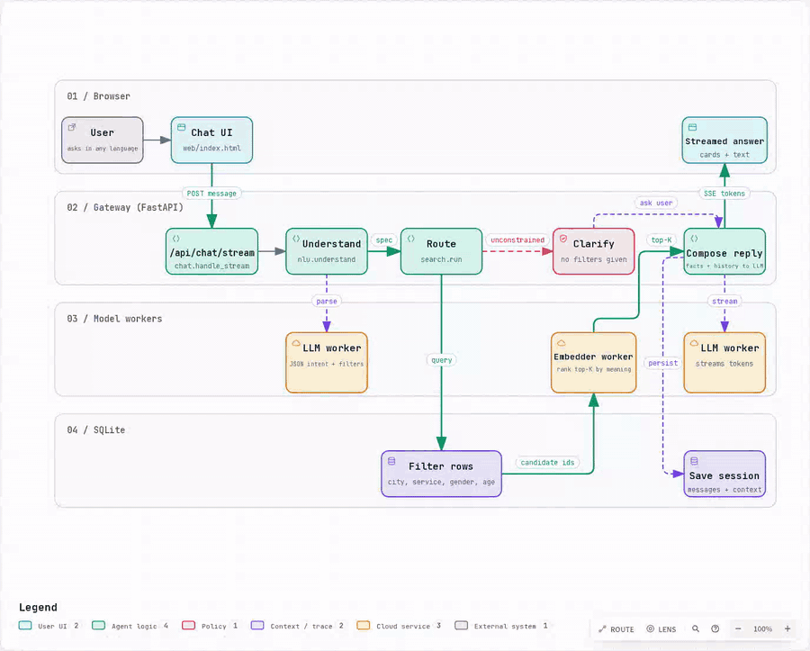
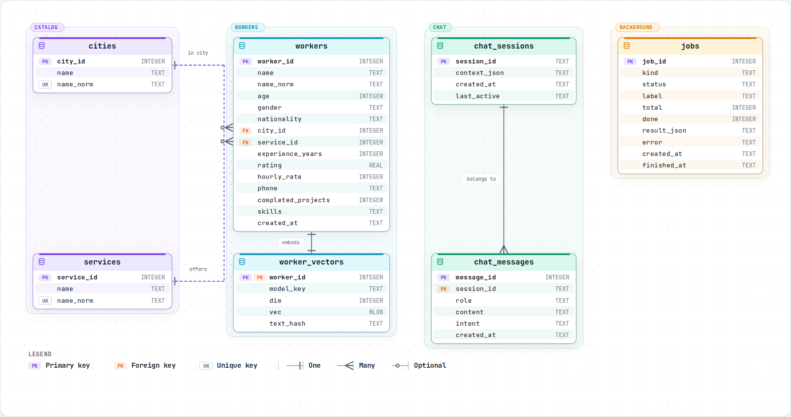
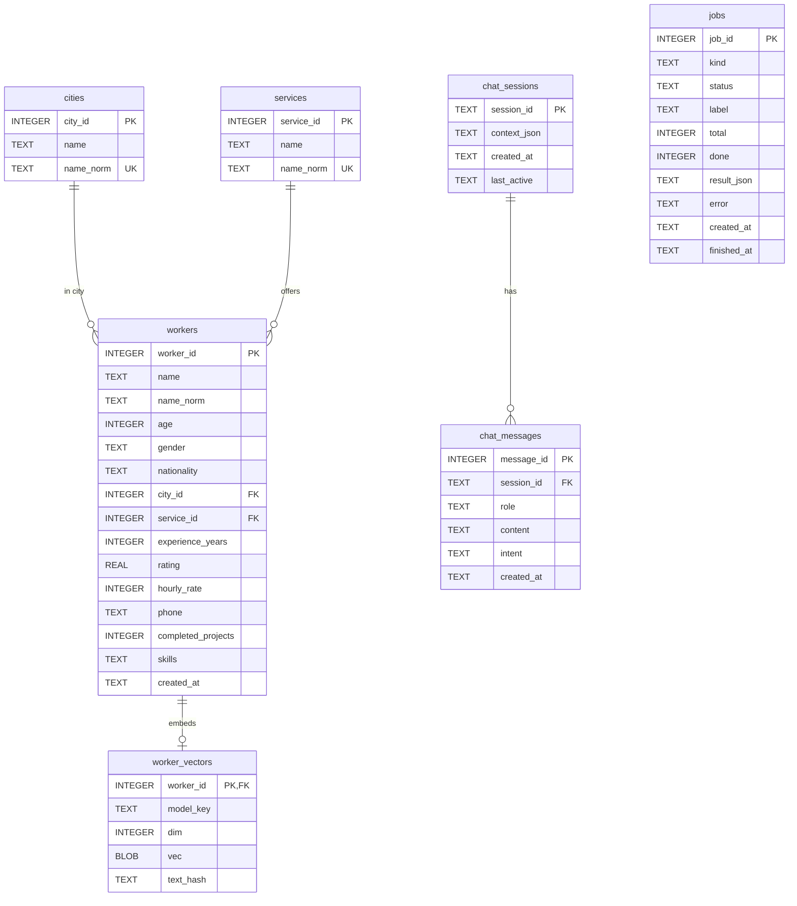
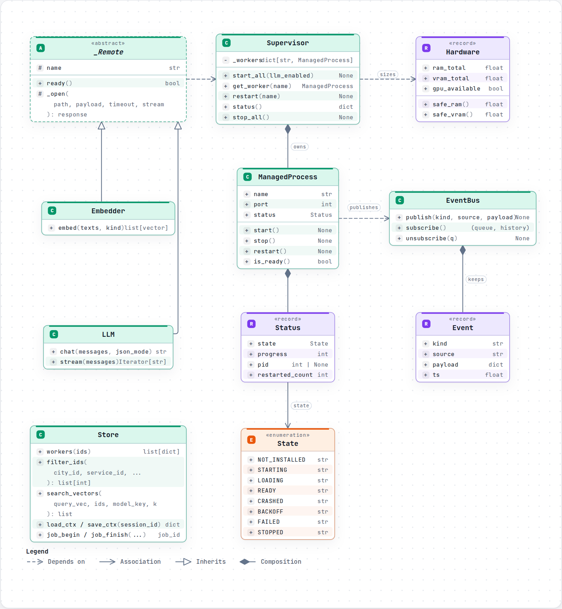
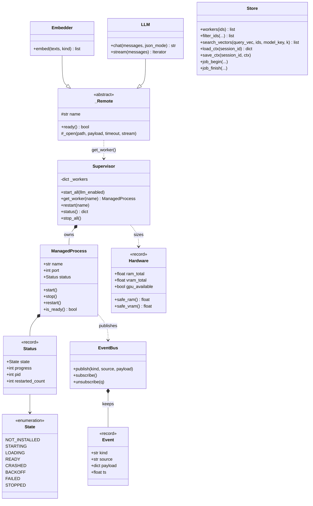

# FindPro - Architecture

Three views of the system: how a chat message flows through it, how the data is stored, and how the runtime classes relate.

## 1. Workflow - life of a chat message



A message enters through `POST /api/chat/stream`. The gateway asks the local LLM worker to turn it into a structured request (`nlu.understand`), then `search.run` picks a route:

- **SQL route** for sorted queries ("best rated", "cheapest").
- **Semantic route** filters rows in SQLite, then the embedder worker re-ranks the candidates.
- **Fallback** widens the city when nothing matches.
- **Clarify** when the message has no filters at all.

`chat.handle_stream` then composes the reply with the LLM worker, streams it back over SSE, and saves the session.

Interactive version (open locally in a browser): [`diagrams/workflow.html`](diagrams/workflow.html) - press **Live** to play the animation.

## 2. ERD - SQLite schema



Interactive version: [`diagrams/erd.html`](diagrams/erd.html). Source of truth: `src/db.py` (`SCHEMA`).



Delete behaviour: removing a city or service sets `workers.city_id` / `service_id` to `NULL`; removing a worker cascades to `worker_vectors`; removing a chat session cascades to its messages. `jobs` has no foreign keys.

## 3. UML - runtime classes



Interactive version: [`diagrams/uml-class.html`](diagrams/uml-class.html). Sources: `src/runtime.py`, `src/clients.py`, `src/hardware.py`, `src/db.py`.



`Status`, `Event` and `Hardware` are dataclasses (shown as records). `Store` is the SQLite access layer and is used by the gateway modules rather than by the runtime classes, so it has no arrows here.

## Regenerating the diagrams

The JSON files in [`diagrams/src`](diagrams/src) are the inputs for [Archify](https://github.com/tt-a1i/archify):

```bash
node archify/bin/archify.mjs finalize erd      docs/diagrams/src/erd.json       docs/diagrams/erd.html       --quality standard
node archify/bin/archify.mjs finalize class    docs/diagrams/src/uml-class.json docs/diagrams/uml-class.html --quality standard
node archify/bin/archify.mjs finalize workflow docs/diagrams/src/workflow.json  docs/diagrams/workflow.html  --quality showcase
```
